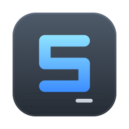
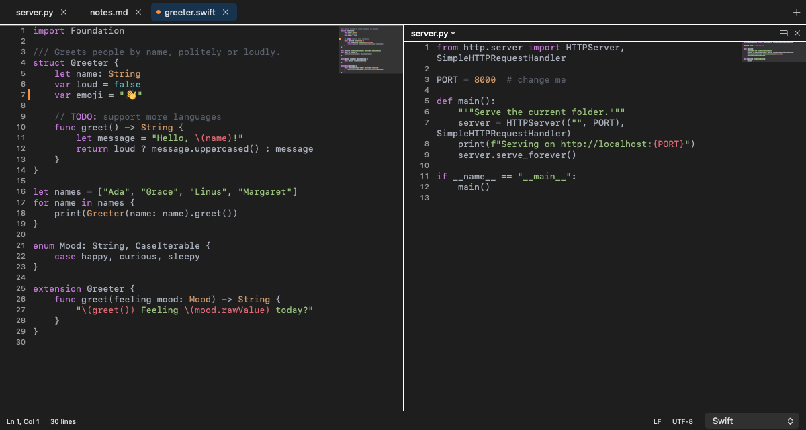
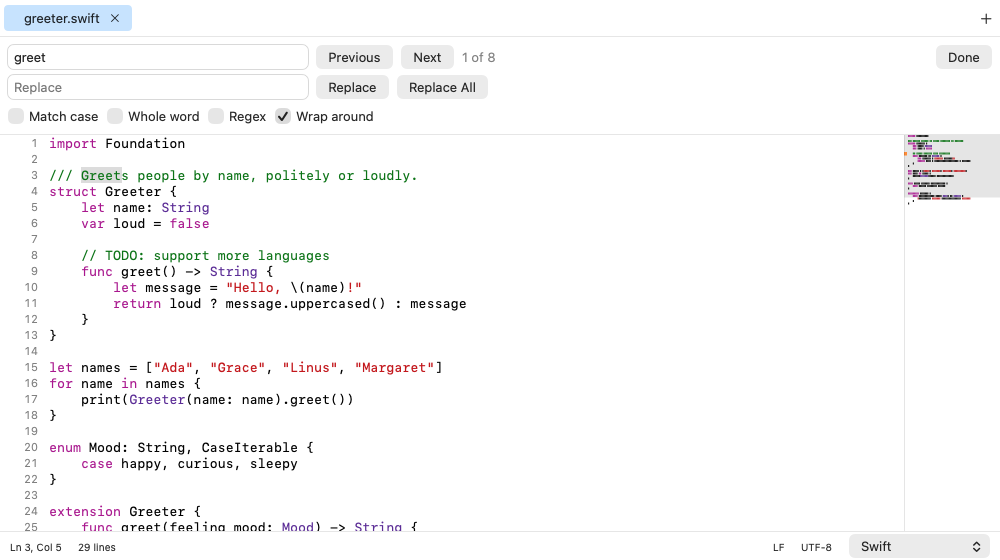

<p align="center"></p>

# Slate

A fast, native text and code editor for macOS, inspired by Notepad++. Written in Swift with AppKit and SwiftUI.



## Features

- **Tabs** with unsaved-change dots, and your files reopened at launch
- **Syntax highlighting** for 33 languages, including Swift, Python, JavaScript, TypeScript, C, C++, C#, Go, Rust, Java, Bash, PowerShell, Windows Batch, SQL, HTML, CSS, JSON, YAML, Markdown, Dockerfile and INI, with a Language menu to pick one yourself
- **Find and replace** with match case, whole word, regular expressions (`$1` and `\n` in replacements) and wrap around
- **Split view**: the same file or two different files, side by side or stacked
- **Document map** (minimap) beside each pane; click it to scroll, with TODO and FIXME ticks
- **Line operations** like Notepad++'s: duplicate, delete, move, join, sort, reverse, remove duplicates or empty lines, and trim
- **Change history** in the margin: orange for unsaved edits, green once saved
- **Git**, read-only: branch and changed-line counts, marks in the margin, and a changes view. Slate never modifies a repository
- **Macros**: record typing and editing keys, play them back many times, and save them
- Go to Line, zoom, recent files, word wrap, line numbers, and light and dark mode
- Careful with your files: keeps their encoding (UTF-8, UTF-8 with BOM, UTF-16, Windows-1252), line endings (LF, CRLF, CR, even mixed), symlinks and permissions, and warns if another app changed a file before you save



## Install

1. Download `Slate-<version>.dmg` from [Releases](../../releases).
2. Open it and drag **Slate** onto **Applications**.
3. Open Slate. Because it isn't signed with an Apple Developer ID yet, macOS will stop it the first time:
   - Open **System Settings > Privacy & Security**, scroll down to the message about Slate, and click **Open Anyway**.
   - Confirm, and Slate opens normally from then on.

Requires macOS 14 Sonoma or later, on Apple silicon or Intel.

## Keyboard shortcuts

| Action | Shortcut |
|---|---|
| New, Open, Save, Save As, Save All | ⌘N, ⌘O, ⌘S, ⇧⌘S, ⌥⌘S |
| Close tab | ⌘W |
| Find, Replace, Find next / previous | ⌘F, ⌥⌘F, ⌘G / ⇧⌘G |
| Go to line | ⌘L |
| Duplicate line, delete line | ⌘D, ⇧⌘K |
| Move line up / down, join lines | ⌃⌘↑ / ⌃⌘↓, ⌃⌘J |
| Split editor | ⌘\\ |
| Document map, word wrap | ⌥⌘M, ⌥Z |
| Zoom in / out / actual size | ⌘=, ⌘-, ⌘0 |
| Show changes since last commit | ⇧⌘D |
| Record macro, play macro | ⌃⌘R, ⌃⌘P |
| Next / previous tab | ⇧⌘] / ⇧⌘[ |

## Build from source

You need Xcode 15 or later.

```bash
git clone https://github.com/atifrather001/slate.git
cd slate
swift build                 # or open Package.swift in Xcode and press ⌘R
swift test
./Scripts/build-app.sh      # makes .build/app/Slate.app
./Scripts/make-dmg.sh       # makes ../Slate-<version>.dmg
```

`swift build` works with only the Command Line Tools; the tests and the universal app need Xcode.

## Credits

- [Highlightr](https://github.com/raspu/Highlightr) and [highlight.js](https://highlightjs.org) for syntax highlighting
- [Swift Collections](https://github.com/apple/swift-collections)
- Inspired by [Notepad++](https://notepad-plus-plus.org). Slate is an independent project and isn't affiliated with Notepad++.

## License

MIT. See [LICENSE](LICENSE).
